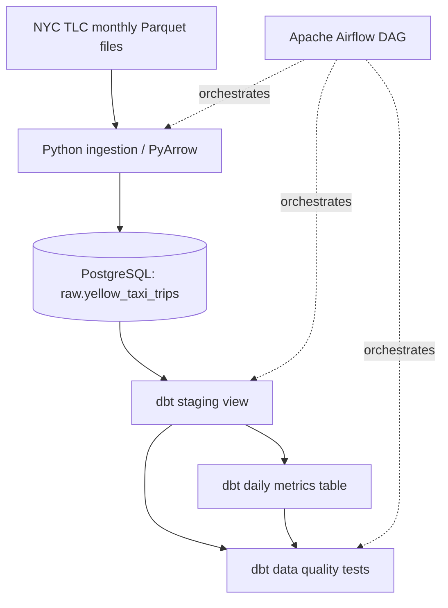

# NYC Taxi Data Engineering Pipeline

A local data engineering project that loads public NYC yellow taxi trips into PostgreSQL, transforms them with dbt Core, and orchestrates ingestion and data-quality checks with Apache Airflow. It uses Docker Compose and runs without paid cloud services.

The project focuses on a practical question: can the same pipeline process different monthly files, reject unusable trip records from the analytical layer, and run again without duplicating the raw data?

## What it does

1. **Extract and load:** Python downloads official NYC TLC Yellow Taxi Parquet files and loads a configurable number of source rows into PostgreSQL.
2. **Avoid duplicate loads:** A unique constraint on `(source_file, source_row_number)` makes repeated ingestion of the same source rows idempotent.
3. **Transform:** dbt creates a cleaned trip view and a daily metrics table.
4. **Validate:** Seven dbt tests check key uniqueness, non-null fields, reconciliation between staging and daily aggregates, and whether the selected months have data.
5. **Orchestrate:** Airflow runs three parameterized monthly ingestion tasks, followed by dbt models and tests. It supports retries and displays task logs and execution status.

## Architecture



**Technologies:** Python, PyArrow, psycopg, PostgreSQL 16, SQL, dbt Core, Apache Airflow 3, Docker Compose, Git.

## Dataset and scope

- **Source:** [NYC Taxi & Limousine Commission trip record data](https://www.nyc.gov/site/tlc/about/tlc-trip-record-data.page)
- **Dataset:** Yellow Taxi monthly trip records in Parquet format
- **Main analysis period:** July–September 2026
- **Sample size:** First 20,000 source rows from each of those three monthly files
- **Additional raw sample:** 150,000 rows from January 2024, retained for ingestion demonstrations but excluded from the default 2026 dbt analysis

The sample is deliberately capped for fast, low-cost local execution. The monthly metrics **do not** represent complete NYC taxi activity. Amounts are sums of the dataset's `total_amount` field, not audited business revenue.

## Example results from a verified local run

| Metric | Result |
|---|---:|
| All raw records in local PostgreSQL | 210,000 |
| Cleaned 2026 records across three monthly samples | 57,472 |
| Data quality tests | 7 passed |
| dbt models | 2 |
| Airflow tasks per run | 5 |

| Sample month | Cleaned trips | Sum of total amount (USD) |
|---|---:|---:|
| July 2026 | 19,159 | 530,523.65 |
| August 2026 | 19,068 | 525,436.94 |
| September 2026 | 19,245 | 558,123.92 |
| **Total** | **57,472** | **1,614,084.51** |

The figures above come from a successful local run on 13 November 2026. The 210,000 raw rows include a separate 150,000-row January 2024 demonstration. **A fresh clone run with the default Airflow parameters loads 60,000 raw rows**, not 210,000; the dbt analytical sample covers the three selected 2026 months. Repeated ingestion of the same sampled Parquet files did not increase the raw table's row count.

## Project structure

```text
.
├── airflow/
│   ├── dags/nyc_taxi_pipeline.py      # Parameterized Airflow DAG
│   └── dbt_profiles/profiles.yml      # dbt connection for Docker
├── dbt/
│   ├── models/                        # Staging and daily metrics SQL
│   ├── tests/                         # Custom dbt assertions
│   ├── dbt_project.yml
│   └── profiles.example.yml           # Example local dbt connection
├── docs/                              # Screenshots and project evidence
├── src/                               # Python ingestion and checks
├── sql/                               # Standalone SQL checks
├── Dockerfile.airflow
├── docker-compose.yml
├── docker-compose.airflow.yml
└── requirements.txt
```

## Run locally (Windows PowerShell)

**Requirements:** Docker Desktop (Linux containers), Windows PowerShell and internet access for public Parquet downloads. Python 3.13 is needed for optional host-side dbt and ingestion commands; the Airflow container includes its own Python environment.

From the project root:

```powershell
py -3.13 -m venv .venv
.\.venv\Scripts\python.exe -m pip install -r requirements.txt
.\.venv\Scripts\python.exe -m pip install 'dbt-core>=1.12,<1.13' 'dbt-postgres==1.11.0'

Copy-Item .\dbt\profiles.example.yml .\dbt\profiles.yml

docker compose -f docker-compose.yml -f docker-compose.airflow.yml up -d --build
```

The example profile uses the demo PostgreSQL connection from `docker-compose.yml`. Replace local demo credentials before using this setup outside a personal development machine. The Airflow container uses `airflow/dbt_profiles/profiles.yml` and connection environment variables.

Open **http://localhost:8080** and select the **`nyc_taxi_pipeline`** DAG. On a fresh Airflow standalone installation, credentials are generated automatically. To retrieve them, use:

```powershell
docker compose -f docker-compose.yml -f docker-compose.airflow.yml exec -T airflow cat /opt/airflow/simple_auth_manager_passwords.json.generated
```

Select the DAG. Trigger it with these parameters:

| Parameter | Value |
|---|---:|
| `year` | `2026` |
| `month_1` | `7` |
| `month_2` | `8` |
| `month_3` | `9` |
| `limit` | `20000` |

You can also inspect the data or run dbt locally after the Docker stack is up:

```powershell
.\.venv\Scripts\python.exe -m src.check
.\.venv\Scripts\dbt.exe build --project-dir .\dbt --profiles-dir .\dbt

docker compose exec -T postgres psql -U taxi_dev -d nyc_taxi -c "SELECT source_file, COUNT(*) FROM raw.yellow_taxi_trips GROUP BY source_file ORDER BY source_file;"
```

**Note:** Airflow has no automatic schedule in this demo (`schedule=None`). It is triggered manually, but each run automatically executes the five dependent tasks in order. The dbt analysis period is set by the Airflow parameters; select months for which the official dataset is available.

## Data quality

The seven dbt tests cover:

- Unique and non-null trip IDs in staging
- Unique and non-null daily metric dates
- Non-null daily trip counts
- Reconciliation of the staging row count against aggregated daily trip counts
- Presence of each selected month in the cleaned data

The staging model also filters out records with invalid timestamps, non-positive trip distance, or negative total amount. Raw rows are retained for inspection.

## Evidence

The screenshot below shows a successful five-task Airflow run using the configurable monthly ingestion tasks:


## Limits and next improvements

This is a **local portfolio project**, not a production deployment. It handles bounded samples, three user-selected months per run, and basic data quality. It does not implement unattended ingestion of newly published months, a cloud deployment, alert delivery, or a full historical backfill. Those are potential extensions rather than completed features.

## Stop services

```powershell
docker compose -f docker-compose.yml -f docker-compose.airflow.yml down
```

The PostgreSQL named volume is preserved by this command. Do not use `down -v` unless you intend to delete the stored database.

## Repository notes

- The `data/` directory, `.venv/`, generated dbt files and local PostgreSQL volume are **excluded from Git**. Official taxi Parquet files are downloaded at runtime.
- The PostgreSQL login in these Compose files is a **local demonstration credential**, not a production secret. PostgreSQL and Airflow bind to `127.0.0.1` for local use only.
- This repository contains the complete example project code. No access to the original developer's database or Airflow instance is required to reproduce the example with public data.

## Data attribution

Public trip record data is provided by the [NYC Taxi & Limousine Commission](https://www.nyc.gov/site/tlc/about/tlc-trip-record-data.page). This independent educational project is not affiliated with NYC TLC. Original Parquet files are downloaded locally and are not committed to this repository.
